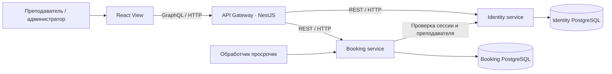
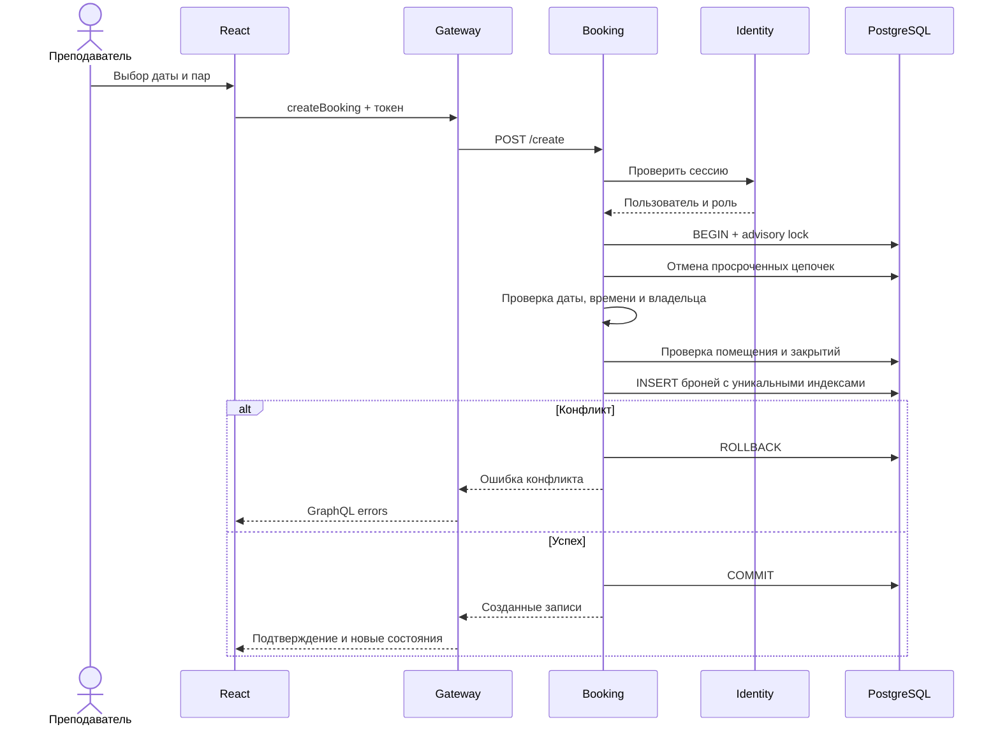
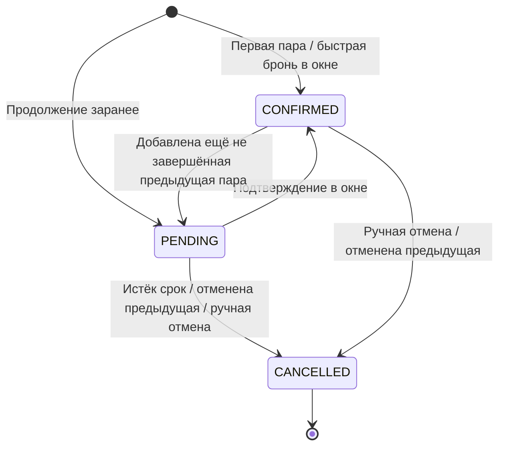
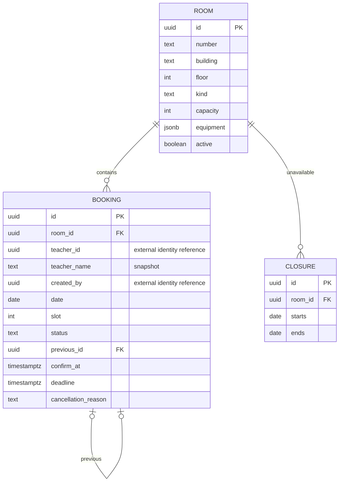
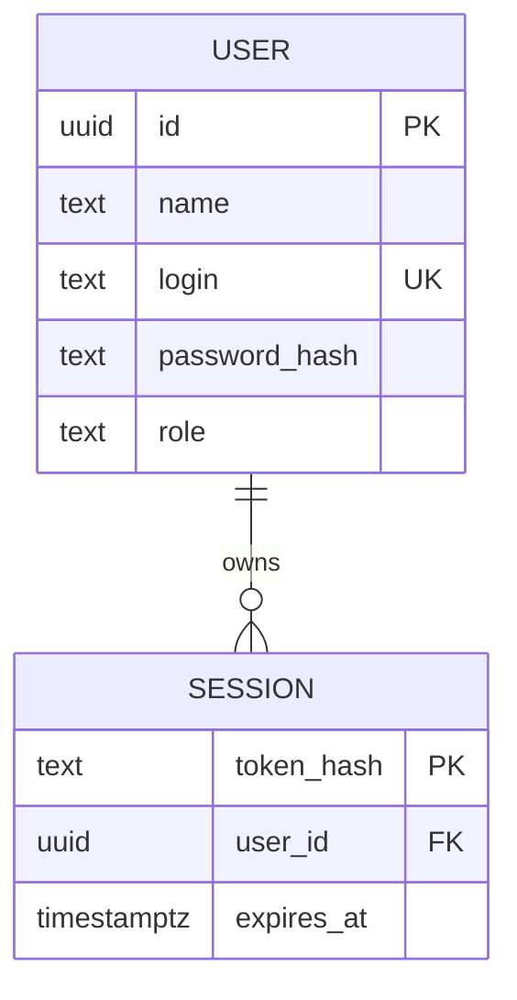
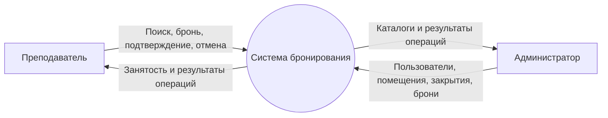
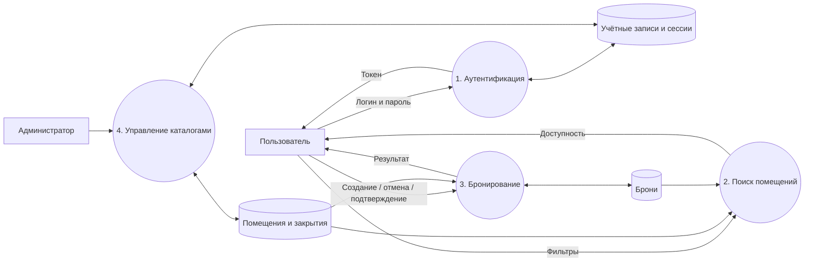
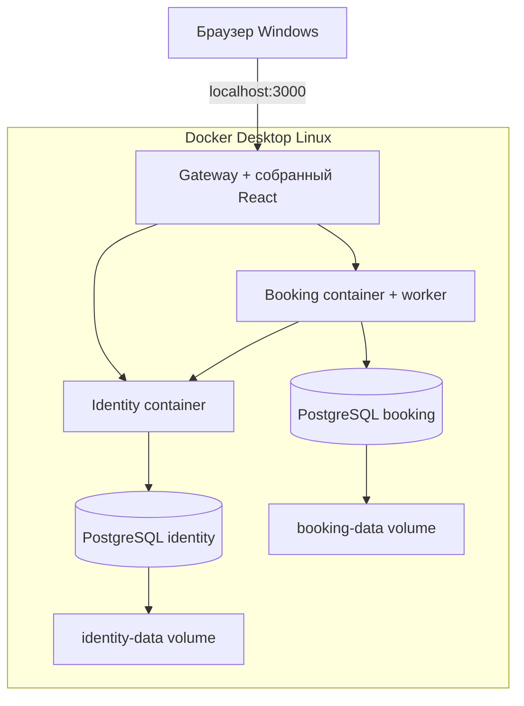

# Архитектура

## Выбор

Обычный монолит проще развернуть, но слабее показывает распределённое взаимодействие. Модульный монолит был бы разумен для реального малого продукта. Для задания выбрана компактная микросервисная архитектура: Identity и Booking с отдельными PostgreSQL базами и GraphQL API Gateway. Помещения и брони остаются в одном сервисе ради атомарной проверки доступности. Шлюз не содержит предметных правил. Брокер сообщений, Saga и CQRS для текущих сценариев не требуются.

## Паттерны

- API Gateway: GraphQL с явным SDL, единая внешняя точка входа, адаптация к внутренним REST-командам.
- MVC: React — представление; NestJS HTTP-контроллеры — приём и маршрутизация; BookingStore и PostgreSQL — модель. Это адаптация ответственности MVC для SPA, а не классический серверный рендеринг MVC.
- Service Layer: BookingStore реализует атомарные предметные операции. В MVP сервис и repository объединены в одном классе; отдельный Repository как реализованный паттерн не заявляется.
- Database per Service: отдельные БД, отсутствие межсервисных SQL JOIN. Identity отдаёт данные преподавателя через API; в брони хранится снимок имени.
- Dependency Injection применена явно через конструктор BookingStore: подключение БД и часы подменяются в тестах. Контроллеры регистрируются контейнером NestJS.

## Целостность и отказоустойчивость

Все изменения бронирований и закрытий выполняются в транзакциях PostgreSQL с общей advisory-блокировкой для MVP. Два частичных уникальных индекса запрещают действующие дубликаты `(room_id,date,slot)` и `(teacher_id,date,slot)`. Благодаря фиксированным непересекающимся парам здесь достаточно уникальности, диапазонные EXCLUDE-ограничения не нужны.

Серверный обработчик отменяет просроченные цепочки. Та же обработка выполняется перед предметными операциями и на старте. Состояние хранится в БД, а не в памяти таймера. Рекурсивная связь только с предыдущим номером пары исключает циклы при штатных операциях.

Identity выдаёт непрозрачные токены; остальные сервисы проверяют сессию через Identity и сами проверяют права. Межсервисный ключ отделяет внутренние HTTP-методы от внешнего API. В Compose наружу опубликован только Gateway на localhost. Зависимость от Identity означает, что при его отказе защищённые операции недоступны. Таймаут внутренних запросов — 8 секунд.

## Структура компонентов (UML-представление)

## Последовательность создания брони

## Состояния брони

Завершение пары определяется по времени, отдельный статус COMPLETED не нужен. Историческая подтверждённая запись остаётся CONFIRMED.

## ER: сервис бронирований

## ER: сервис пользователей

## DFD: контекст

## DFD: первый уровень

## Развёртывание

Диаграммы — исходные модели для дальнейшего оформления. Mermaid flowchart выше не заменяет строго оформленные UML Use Case/Component/Deployment, если преподаватель требует нотацию UML в draw.io. Финальное графическое оформление и полный текст пояснительной записки — отдельный следующий этап.

## Основания выбора технологий

TypeScript используется на клиенте и сервере; общие типы ограничивают расхождения. NestJS предоставляет HTTP-контроллеры и структуру модулей. GraphQL.js исполняет явную SDL-схему внутри контроллера Gateway; Apollo не требуется. PostgreSQL обеспечивает транзакции и уникальные частичные индексы. Docker Compose даёт воспроизводимый локальный стенд. React обслуживает интерактивное расписание.

Документация: https://docs.nestjs.com/controllers · https://graphql.org/learn/schema/ · https://www.postgresql.org/docs/17/indexes-partial.html
