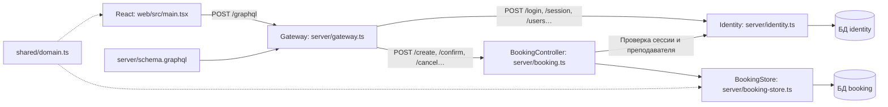

# Справочник по файлам и функциям приложения «Кампус»

Дата сверки с исходниками: **9 октября 2026 года**. Версия приложения в `package.json`: **0.1.0**.

Документ объясняет существующий код: за что отвечает каждый файл проекта, какие функции в нём определены, что они получают и возвращают, как изменяют данные и вызывают друг друга. Это описание реализации, а не перечень планируемых возможностей. Здесь также разобраны обработчики форм, таймеров и кнопок, у которых нет отдельного имени в коде.

Сторонние библиотеки из `node_modules` и внутренние файлы Git не являются исходниками приложения и не разбираются по функциям. Для результатов сборки приведено соответствие исходным файлам: их не нужно редактировать вручную. Для конфигураций, CSS и Markdown вместо функций объяснены назначение и разделы.

## Содержание

- [1. Как устроено приложение](#overview)
- [2. Карта файлов](#file-map)
- [3. Общие типы и правила времени](#domain)
- [4. Общие серверные функции](#common)
- [5. Сервис пользователей](#identity)
- [6. Сервис бронирования: HTTP-контроллер](#booking-controller)
- [7. Сервис бронирования: бизнес-логика и PostgreSQL](#booking-store)
- [8. GraphQL-шлюз и схема API](#gateway)
- [9. Веб-интерфейс](#frontend)
- [10. Скрипты запуска и проверки](#scripts)
- [11. Автоматические тесты](#tests)
- [12. Сборка и зависимости](#build)
- [13. Docker, Jenkins и Kubernetes](#infrastructure)
- [14. Документы, IDE и сгенерированные файлы](#other-files)
- [15. Переменные окружения](#environment)
- [16. Путь запроса через файлы](#flows)
- [17. Где менять конкретное поведение](#change-map)
- [18. Особенности текущей реализации](#implementation-notes)

<a id="overview"></a>

## 1. Как устроено приложение

Приложение состоит из браузерного клиента и трёх серверных процессов. У двух предметных сервисов отдельные базы PostgreSQL.



| Часть | Что делает | Где запускается |
|---|---|---|
| React-клиент | Показывает расписание, формы и результаты операций | Браузер |
| Gateway | Исполняет GraphQL-запросы, пересылает операции сервисам, раздаёт собранный клиент | Node.js, порт 3000 |
| Identity | Проверяет логины, пароли и сессии, создаёт пользователей | Node.js, порт 3001 |
| Booking | Управляет помещениями, бронированиями и закрытиями, отменяет просрочки | Node.js, порт 3002 |
| PostgreSQL identity | Хранит пользователей и сессии | Отдельный контейнер БД |
| PostgreSQL booking | Хранит помещения, брони и закрытия | Отдельный контейнер БД |

В Docker Compose наружу опубликован только порт Gateway, привязанный к `127.0.0.1`. Сервисы взаимодействуют через HTTP; они не читают чужие таблицы напрямую. `shared/domain.ts` — общий исходный модуль, а не отдельный сетевой сервис.

Короткие определения: **контроллер** принимает HTTP-запрос; **resolver** исполняет поле GraphQL; **guard** проверяет допуск к контроллеру; **транзакция** сохраняет группу изменений целиком либо отменяет её; **callback** — функция, переданная другой функции или обработчику события.

<a id="file-map"></a>

## 2. Карта файлов

Пути в этом справочнике указаны относительно корня проекта.

```text
Arch_project/
├── shared/domain.ts             Общие типы, расписание, проверки времени
├── server/
│   ├── common.ts                Соединения, HTTP-вызовы, пароли, проверки доступа
│   ├── identity.ts              Сервис учётных записей и сессий
│   ├── booking.ts               HTTP-интерфейс сервиса бронирования
│   ├── booking-store.ts         Транзакции и предметные правила
│   ├── gateway.ts               GraphQL-шлюз и статические файлы клиента
│   └── schema.graphql           Контракт внешнего API
├── web/
│   ├── index.html               HTML-точка входа
│   └── src/
│       ├── main.tsx             React-приложение и обработчики интерфейса
│       └── style.css            Оформление и адаптивная компоновка
├── scripts/
│   ├── dev.mjs                  Совместный запуск процессов для разработки
│   └── smoke.mjs                Проверка работающего API
├── tests/
│   ├── domain.test.ts           Проверки расписания и времени
│   └── booking.test.ts          Проверка правил на PostgreSQL
├── infra/
│   ├── generate-k8s.mjs         Генератор Kubernetes-манифеста
│   ├── local.yaml               Сгенерированные ресурсы кластера
│   └── README.md                Инструкция по инфраструктуре
├── docs/
│   ├── requirements.md         Согласованные требования
│   ├── architecture.md         Архитектурные решения и диаграммы
│   ├── verification.md         Отчёт о выполненных проверках
│   ├── code-reference.md       Этот справочник
│   └── screenshots/login.png   Снимок экрана входа
├── package.json                 Зависимости и npm-команды
├── package-lock.json            Зафиксированное дерево зависимостей
├── tsconfig.json                Компиляция TypeScript
├── vite.config.ts               Сборка и dev-сервер клиента
├── Dockerfile                   Сборка общего образа приложения
├── compose.yaml                 Основной локальный стенд
├── compose.test.yaml            Изолированный тестовый стенд
├── Jenkinsfile                  CI-проверки и сборка образа
├── .env.example                 Пример настроек окружения
├── .gitignore                   Исключения для Git
├── .dockerignore                Исключения из контекста Docker-сборки
├── README.md                    Главная инструкция
└── .idea/                       Локальная конфигурация IntelliJ IDEA
```

Дополнительно после установки и сборки существуют `node_modules/`, `dist/`, `web-dist/`, `.git/` и журналы `.local-*.log`. Они разобраны в разделе 14.

<a id="domain"></a>

## 3. `shared/domain.ts` — типы и правила времени

**Ответственность:** описать общие данные и фиксированное расписание. Файл используется клиентом, сервером бронирований, шлюзом и тестами. Не обращается к сети или БД.

### Константа `SLOTS`

Массив из шести объектов `{ number, start, end }`:

| Пара | Начало | Конец |
|---|---|---|
| 1 | 09:00 | 10:30 |
| 2 | 10:40 | 12:10 |
| 3 | 12:40 | 14:10 |
| 4 | 14:20 | 15:50 |
| 5 | 16:20 | 17:50 |
| 6 | 18:00 | 19:30 |

### Типы

| Тип | Поля и смысл |
|---|---|
| `User` | `id`, `name`, `login`, `role`. Роль — `ADMIN` либо `TEACHER`; пароля здесь нет |
| `Room` | `id`, `number`, `building`, `floor`, `kind`, `capacity`, `equipment`, `active`. Тип помещения — `CLASSROOM` либо `LAB` |
| `Booking` | Идентификатор, помещение, преподаватель, снимок его имени, автор записи, дата, пара, статус, связь с предыдущей бронью и сроки подтверждения |

В `Booking` поля `teacherId` и `createdBy` различаются: администратор создаёт запись, но пользоваться помещением будет указанный преподаватель. `previousId` связывает последовательность; `confirmAt` и `deadline` задают окно подтверждения; `cancellationReason` хранит автоматически выбранное объяснение отмены.

### Функции

| Функция | Вход | Результат и поведение |
|---|---|---|
| `today(now = new Date()): string` | Момент времени, по умолчанию текущий | Возвращает московскую календарную дату `YYYY-MM-DD` через `Intl.DateTimeFormat`; не использует локальную дату ОС |
| `addDays(date, count): string` | Дата и число дней | Создаёт UTC-дату в полдень, прибавляет дни, возвращает `YYYY-MM-DD`. Корректно переходит между месяцами и годами |
| `slotTime(date, slot, edge): Date` | Дата, номер пары, `start` или `end` | Находит пару в `SLOTS`, строит точный момент с `+03:00`; при неизвестном номере бросает исключение |
| `validateBookingDate(date, slot, now): void` | Дата, пара и момент проверки | Проверяет реальность даты, горизонт «сегодня + 6 дней», запрет воскресенья и то, что пара ещё не закончилась. При нарушении бросает понятную ошибку; при успехе ничего не возвращает |
| `confirmationWindow(date, previousSlot)` | Дата и номер предыдущей пары | Возвращает `{ confirmAt, deadline }` как ISO-строки. Окно начинается за 10 минут до конца предыдущей пары и заканчивается в момент её окончания |

Начавшуюся пару можно забронировать: проверка сравнивает текущее время с **окончанием**, а не с началом. В момент окончания она уже недоступна. Для первой пары окно подтверждения следующей — `[10:20; 10:30)`: левая граница включена, правая исключена.

<a id="common"></a>

## 4. `server/common.ts` — общие серверные функции

**Ответственность:** переиспользуемые технические операции. Импорт `reflect-metadata` обеспечивает поддержку метаданных декораторов NestJS. Основные зависимости: `pg`, `node:crypto`, NestJS, встроенный `fetch`.

### Константы

| Константа | Значение |
|---|---|
| `internalKey` | `INTERNAL_KEY` либо локальный демонстрационный ключ |
| `identityUrl` | `IDENTITY_URL` либо `http://127.0.0.1:3001` |
| `bookingUrl` | `BOOKING_URL` либо `http://127.0.0.1:3002` |

Они вычисляются при загрузке модуля. Изменение окружения уже работающего процесса не обновляет эти значения автоматически.

### Функции и класс

| Элемент | Вход → результат | Действие |
|---|---|---|
| `pool(name)` | Имя БД → `Pool` | Создаёт пул PostgreSQL. Приоритет у `DATABASE_URL`; иначе используется локальный адрес БД с переданным именем. Схему не создаёт |
| `hashPassword(password)` | Пароль → строка `salt:hash` | Создаёт 16 случайных байт соли, вычисляет 64-байтный scrypt-хеш, кодирует обе части в hex |
| `checkPassword(password, stored)` | Пароль и сохранённая строка → `boolean` | Разделяет соль/хеш, вычисляет scrypt и сравнивает буферы через `timingSafeEqual` |
| `remote(url, path, body, token?)` | Адрес, путь, тело, заголовок авторизации → JSON-ответ | Выполняет внутренний POST: JSON, `x-internal-key`, `authorization`, таймаут 8 секунд. При HTTP-ошибке бросает `Error` с сообщением сервиса |
| `InternalGuard.canActivate(ctx)` | Контекст HTTP-запроса → `true` или исключение | Сравнивает `x-internal-key` с общим ключом. При несовпадении бросает `UnauthorizedException` |
| `authenticate(token?)` | Заголовок авторизации → `Promise<User>` | При отсутствии заголовка сразу отказывает; иначе вызывает Identity `/session` через `remote` |
| `requireAdmin(user)` | Пользователь → `void` | Бросает ошибку, если роль отличается от `ADMIN` |

`InternalGuard` проверяет межсервисный ключ, а `authenticate` — пользовательскую сессию. Это две отдельные проверки. `remote` передаёт токен как получил: самостоятельно префикс `Bearer` не добавляет. Повторных попыток запроса в нём нет.

<a id="identity"></a>

## 5. `server/identity.ts` — сервис пользователей

**Ответственность:** учётные записи, вход/выход и сессии. Использует пул `db = pool("identity")`. Таблицы — `users` и `sessions`.

### Функции уровня модуля

| Функция | Вход → результат | Как работает |
|---|---|---|
| `digest(token)` | Строка токена → SHA-256 в hex | Удаляет начальный `Bearer `, хеширует оставшуюся строку. Используется для записи и поиска сессий |
| `publicUser(u)` | Строка пользователя из БД → объект пользователя | Оставляет только `id`, `name`, `login`, `role`, исключая `password_hash` |
| `session(token)` | Токен → публичный пользователь | Соединяет `users` и `sessions`, ищет хеш токена и проверяет `expires_at > now()` средствами PostgreSQL. Если сессии нет, бросает ошибку |
| `main()` | Нет → `Promise<void>` | Создаёт таблицы, при необходимости добавляет демо-пользователей, запускает NestJS на `PORT` или 3001 |

### `IdentityController.health()`

Обрабатывает `GET /health`. Выполняет `SELECT 1` и возвращает `{ ok: true }`, если PostgreSQL отвечает. Пользовательская сессия и межсервисный ключ для этого маршрута не требуются.

### `IdentityController.handle(body, token, operation)`

Один метод обслуживает внутренний маршрут `POST /:operation`. Перед ним выполняется `InternalGuard`. Далее поведение определяется сегментом пути:

| Операция | Доступ | Вход | Действие и ответ |
|---|---|---|---|
| `/login` | Без пользовательской сессии, но с внутренним ключом | `login`, `password` | Валидирует поля, ищет логин, проверяет пароль, создаёт случайный 32-байтный токен. Сохраняет его хеш и срок 12 часов. Возвращает `{ token, user }` |
| `/session` | Действующая сессия | Токен в заголовке | Возвращает текущего пользователя |
| `/logout` | Действующая сессия | Токен в заголовке | Удаляет строку сессии по хешу; возвращает `true` |
| `/users` | Администратор | Пустой объект | Возвращает пользователей, отсортированных по имени |
| `/user` | Администратор | `id` — UUID | Возвращает одного пользователя; используется Booking при оформлении от чужого имени |
| `/create-user` | Администратор | `name`, `login`, `password`, `role` | Валидирует поля, хеширует пароль, вставляет пользователя и возвращает публичные поля |

Валидация создания: имя 2–100 символов после `trim`; логин — 3–40 латинских букв, цифр, точек, `_` или `-`; пароль 8–128 символов; роль из двух допустимых значений. Для входа схема другая: логин 1–80 символов, пароль до 128.

Блок `catch` преобразует ошибки в `BadRequestException`: нарушение уникальности `23505` — «Логин уже занят», ошибка Zod — сообщение о полях пользователя, остальные — исходное сообщение. Неизвестная операция также вызывает ошибку.

### `IdentityModule` и запуск

`IdentityModule` — класс с декоратором `@Module`, регистрирующий контроллер. Собственных методов нет.

`main()` создаёт таблицы через `CREATE TABLE IF NOT EXISTS`. При `SEED_DEMO === "true"` добавляет `admin`, `teacher`, `petrov` с паролем из `DEMO_PASSWORD` либо демонстрационным значением. `ON CONFLICT(login) DO NOTHING` сохраняет уже существующих пользователей и пароли. Обработчик `main().catch(...)` печатает ошибку и завершает процесс с кодом 1.

<a id="booking-controller"></a>

## 6. `server/booking.ts` — HTTP-интерфейс бронирования

**Ответственность:** принять внутренний HTTP-запрос, установить пользователя, проверить административные права и передать предметную операцию в `BookingStore`.

На уровне файла создаётся `store = new BookingStore(pool("booking"))`. Он общий для запросов внутри одного процесса. Это явно созданный объект; он не зарегистрирован отдельным NestJS provider.

### Методы и функции

| Элемент | Назначение |
|---|---|
| `BookingController.health()` | `GET /health`: проверяет доступность БД через `SELECT 1`, возвращает `{ ok: true }` |
| `BookingController.handle(op, body, token)` | `POST /:operation`: выполняет `authenticate`, выбирает операцию и обрабатывает ошибки |
| `BookingModule` | Регистрирует контроллер в NestJS; своих методов нет |
| `main()` | Инициализирует БД, при необходимости добавляет помещения, обрабатывает просрочки, запускает периодический обработчик и HTTP-сервер |

### Ветви `handle`

| Путь | Вызов | Дополнительные правила |
|---|---|---|
| `/rooms` | `store.rooms()` | Любая действующая сессия |
| `/bookings` | `store.bookings(body.date)` | Любая действующая сессия; дата необязательна |
| `/closures` | `store.closures()` | Любая действующая сессия |
| `/create` | `store.create(body, user, teacher)` | Если `teacherId` чужой, требует `ADMIN` и получает преподавателя через Identity `/user`; иначе использует текущего пользователя |
| `/confirm` | `store.confirm(id, user)` | Проверяет формат UUID; права владельца и время проверяются в Store |
| `/cancel` | `store.cancel(id, user)` | Проверяет UUID; права владельца и время проверяются в Store |
| `/save-room` | `store.saveRoom(body)` | Только администратор |
| `/close-room` | `store.closeRoom(roomId, starts, ends)` | Только администратор; проверяет UUID помещения |
| `/reopen` | `store.reopen(id)` | Только администратор; `id` — идентификатор закрытия |

Все POST-маршруты дополнительно защищены `InternalGuard`. Код PostgreSQL `23505` превращается в сообщение о занятом помещении/преподавателе либо повторяющемся номере помещения. Ошибки Zod превращаются в просьбу проверить ввод. Все эти ошибки возвращаются как `BadRequestException`.

### Фоновые обработчики

В `main()` вызывается `setInterval(..., 5000)`: callback запускает `store.sweep()`, а его `catch` пишет ошибку в журнал. `unref()` позволяет таймеру не удерживать Node-процесс самостоятельно; работающий HTTP-сервер всё равно удерживает процесс. Первая обработка просрочек происходит ещё до запуска HTTP. Ошибка стартового `main()` завершает процесс с кодом 1.

<a id="booking-store"></a>

## 7. `server/booking-store.ts` — правила бронирования и БД

**Ответственность:** обеспечить целостность данных и выполнить предметные операции. В этом MVP один класс объединяет слой бизнес-операций и SQL-доступ. Здесь нет HTTP-маршрутов и React-компонентов.

### Схема `roomInput`

Это Zod-схема, а не функция. Используется в `saveRoom()`:

| Поле | Ограничения |
|---|---|
| `id` | Необязательный UUID; при наличии выбирается обновление |
| `number` | Непустая строка после `trim`, максимум 20 символов |
| `building` | Непустая строка после `trim`, максимум 60 символов |
| `floor` | Целое от −2 до 100 |
| `kind` | `CLASSROOM` или `LAB` |
| `capacity` | Целое от 1 до 1000 |
| `equipment` | До 30 непустых строк, каждая до 60 символов |
| `active` | Логическое значение |

### Конструктор `BookingStore(db, clock = () => new Date())`

Принимает PostgreSQL-пул и функцию часов. Сохраняет `db` как публичное поле, `clock` — как приватное. В тесте передаётся собственная функция часов: можно воспроизводить 10:20 и 10:30 без изменения системного времени. Конструктор не создаёт таблицы — для этого нужен `init()`.

### `init(): Promise<void>`

Создаёт таблицы и индексы, если их ещё нет:

| Объект | Назначение |
|---|---|
| `rooms` | Каталог; уникальная комбинация `building, number` |
| `bookings` | Брони; номер пары 1–6; статус из трёх значений; ссылки на помещение и предыдущую бронь |
| `closures` | Закрытия помещений на даты; конец не раньше начала |
| `room_slot` | Частичный уникальный индекс `(room_id, date, slot)` для неотменённых записей |
| `teacher_slot` | Аналогичный индекс `(teacher_id, date, slot)` |
| `booking_deadline` | Индекс по сроку подтверждения для `PENDING` |

Это начальная инициализация, не система версионируемых миграций: изменение описания `CREATE TABLE IF NOT EXISTS` не обновит автоматически уже существующую таблицу.

### `transaction<T>(fn): Promise<T>`

Получает callback `(client, now) => Promise<T>` и возвращает его результат после успешного сохранения.

1. Берёт соединение из пула и выполняет `BEGIN`.
2. Захватывает `pg_advisory_xact_lock(20261004)`: участвующие в этом механизме операции ожидают друг друга в пределах БД.
3. Один раз получает `now = clock()` для операции.
4. Вызывает `expire(client, now)`.
5. Выполняет переданный callback.
6. Делает `COMMIT`; при исключении — `ROLLBACK` и повторно бросает ошибку.
7. В `finally` возвращает соединение в пул через `release()`.

Важно: очистка просрочек тоже входит в эту транзакцию. Если последующая операция откатится, её очистка откатится вместе с ней; следующий `sweep()` либо успешная операция повторят обработку.

### `cancelTree(client, id, reason): Promise<void>` — приватный метод

Рекурсивным SQL-запросом находит указанную бронь и всех потомков по `previous_id`. Для всех ещё не отменённых записей устанавливает `CANCELLED` и текст причины. Строки не удаляются. Используется и для ручной отмены, и для просрочек; работает в транзакции вызывающего метода.

### `expire(client, now): Promise<void>` — приватный метод

Находит `PENDING` с `deadline <= now`. Для каждой найденной записи вызывает `cancelTree()` с причиной «Не подтверждено вовремя». Не отменяет подтверждённую запись только из-за того, что её пара уже закончилась.

### `sweep(): Promise<boolean>`

Вызывает `transaction(async () => true)`. Пустая предметная часть нужна потому, что сама `transaction()` уже вызывает `expire()`. Используется на старте и каждые 5 секунд. Возвращаемое `true` не является количеством отменённых записей.

### `map(b): Booking`

Преобразует строку БД в API-объект: `room_id → roomId`, `teacher_id → teacherId`, `teacher_name → teacherName`, `created_by → createdBy`, `previous_id → previousId`, поля сроков — в ISO-строки или `null`. Строковую дату оставляет как есть; объект `Date` переводит через `today()`. SQL-запросов не выполняет.

### Методы чтения

| Метод | Аргументы → результат | Особенности |
|---|---|---|
| `bookings(date?)` | Необязательная дата → массив `Booking` | Выполняется через `transaction`, поэтому перед чтением обрабатывает просрочки. Без даты возвращает все записи, включая прошлые и отменённые. Сортировка: дата, пара, время создания |
| `rooms()` | Нет → массив помещений | Читает весь каталог, включая неактивные помещения; сортирует по корпусу и номеру. Не вызывает `transaction` |
| `closures()` | Нет → массив закрытий | Возвращает `id`, `roomId`, `starts`, `ends`; даты — строки. Сортирует по началу. Не вызывает `transaction` |

### `create(input, user, teacher): Promise<Booking[]>`

Аргументы:

- `input`: `{ date, slots: [{ roomId, slot }, ...] }`;
- `user`: автор действия;
- `teacher`: преподаватель, на которого оформляется бронь.

Алгоритм:

1. Zod проверяет наличие 1–6 выбранных пар, UUID помещений и целые номера 1–6.
2. Получатель должен иметь роль `TEACHER`. Неадминистратор может оформлять только на себя.
3. Одна `transaction()` охватывает **все** выбранные пары.
4. Пары сортируются по номеру. Для каждой проверяются дата/время, существование и активность помещения, отсутствие закрытия на эту дату.
5. Ищется действующая бронь преподавателя на непосредственно предыдущую пару той же даты, независимо от аудитории.
6. Если предыдущая пара ещё не закончилась, записываются `previousId` и окно подтверждения. Новая бронь получает `PENDING`, если окно ещё не началось или предыдущая бронь сама ожидает подтверждения. Иначе новая запись сразу `CONFIRMED`.
7. Если подходящей предыдущей брони нет, новая запись сразу `CONFIRMED`.
8. Выполняется `INSERT`. Индексы БД отклоняют конфликт помещения или преподавателя; при этом откатывается весь набор.
9. Если следующая пара уже была забронирована раньше, она привязывается к новой записи и переводится в `PENDING` с пересчитанным окном.
10. Возвращается массив **созданных** броней, преобразованных через `map()`.

При дозаписи предыдущей пары существующая следующая может изменить статус, но не включается в возвращаемый массив новых записей. Клиент после мутации вызывает `refresh()` и получает полное актуальное состояние.

### `confirm(id, user): Promise<boolean>`

В транзакции находит бронь, проверяет владельца либо администратора, статус `PENDING`, условие `confirmAt <= now < deadline` и статус предыдущей записи `CONFIRMED`. После этого меняет статус на `CONFIRMED` и возвращает `true`. Вне окна или для уже подтверждённой записи операция отклоняется. Время и помещение не изменяются.

### `cancel(id, user): Promise<boolean>`

Проверяет существование и права. Преподавателю разрешено только до `slotTime(date, slot, "start")`; администратору такое ограничение не применяется. Вызывает `cancelTree()` и возвращает `true`. Причина выбирается автоматически: «Отменено администратором» либо «Отменено преподавателем». Обязательного поля причины в API нет.

### `saveRoom(input): Promise<Room>`

Валидирует `roomInput`. В транзакции выполняет `UPDATE`, если есть `id`, иначе `INSERT`. Оборудование сериализуется в JSON. Обновление несуществующего помещения отклоняется. При деактивации проверяется отсутствие неотменённых броней с датой **сегодня или позднее**; проверка не различает уже закончившиеся и ещё предстоящие пары сегодняшнего дня.

Метод сам не принимает пользователя: административное право проверяет `BookingController.handle()` до вызова.

### `closeRoom(roomId, starts, ends): Promise<boolean>`

Проверяет формат дат и порядок границ, затем в транзакции ищет действующие брони помещения между датами включительно. При наличии конфликтов отказывает; иначе создаёт строку `closures` и возвращает `true`. Реальность календарных дат и существование помещения дополнительно обеспечиваются типами/ссылками PostgreSQL. Пересекающиеся записи закрытий специально не запрещены.

### `reopen(id): Promise<boolean>`

В транзакции удаляет конкретную строку `closures` и возвращает `true`. Аргумент — UUID **закрытия**, а не помещения. Если записи нет, `DELETE` не изменит строки, но результат всё равно будет `true`. Другие закрытия этого помещения сохраняются.

### `seed(): Promise<void>`

Добавляет четыре демонстрационных помещения: 101 (30 мест), 203 (60), 205 (24), 302 (16) с оборудованием. Для всех указан Главный корпус, этаж извлекается из первой цифры номера. При совпадении корпуса и номера ничего не меняет. Вызывается только при включённом `SEED_DEMO`.

<a id="gateway"></a>

## 8. GraphQL-шлюз и схема API

### `server/gateway.ts`

**Ответственность:** внешняя точка входа. При загрузке читает `server/schema.graphql` относительно текущей рабочей директории и создаёт схему через `buildSchema()`. В `root` хранятся функции выполнения полей GraphQL.

| Элемент | Назначение |
|---|---|
| `root.slots()` | Возвращает общий массив `SLOTS` без сетевого запроса |
| `root.serverTime()` | Возвращает текущий момент шлюза в ISO-формате |
| Callback `root[name] = (args, ctx) => ...` | Для каждой строки таблицы маршрутов создаёт resolver: вызывает `remote(service, path, args.input || args, ctx.token)`. Обёртка `input` раскрывается для `saveRoom` |
| `GatewayController.health()` | `GET /health`: возвращает `{ ok: true }`. В отличие от health предметных сервисов, не проверяет БД и соседние сервисы |
| `GatewayController.query(body, token)` | `POST /graphql`: проверяет, что `query` — строка до 20 000 символов; вызывает `graphql()` со схемой, переменными, именем операции, `root` и токеном в контексте |
| `GatewayModule` | Регистрирует контроллер; своих методов нет |
| `main()` | Создаёт NestExpressApplication, подключает статические файлы `web-dist`, слушает `PORT` либо 3000 на всех интерфейсах контейнера |
| `main().catch(...)` | Пишет ошибку старта и завершает процесс с кодом 1 |

Шлюз использует непосредственно GraphQL.js внутри NestJS-контроллера. В проекте нет Apollo Server и отдельного `GraphQLModule`. Проверки ролей выполняются в предметных сервисах; `slots` и `serverTime` доступны без сессии.

### `server/schema.graphql`

**Ответственность:** описать внешний контракт. В файле нет исполняемых функций; объявления полей связаны с resolver-функциями в `gateway.ts`.

| Тип | Что описывает |
|---|---|
| `User` | Публичные поля пользователя |
| `Auth` | Токен и пользователя после входа |
| `Room` | Помещение и оборудование |
| `Slot` | Номер, начало и окончание пары |
| `Booking` | Бронь, владелец, автор, состояние и сроки |
| `Closure` | Закрытие помещения на диапазон дат |
| `SlotInput` | Помещение и номер выбранной пары |
| `RoomInput` | Поля создания/обновления помещения; `id` необязателен |

`!` означает обязательное ненулевое значение, `[T!]!` — обязательный массив без `null`-элементов. Обязательность массива не запрещает пустой массив сама по себе: число выбранных пар проверяет Zod.

### Все операции и их маршруты

| GraphQL-поле | Параметры | Возвращает | Реализация |
|---|---|---|---|
| Query `me` | Нет | `User!` | Identity `/session` |
| Query `rooms` | Нет | `[Room!]!` | Booking `/rooms` |
| Query `bookings` | `date: String` необязателен | `[Booking!]!` | Booking `/bookings` |
| Query `closures` | Нет | `[Closure!]!` | Booking `/closures` |
| Query `users` | Нет | `[User!]!` | Identity `/users`, только ADMIN |
| Query `slots` | Нет | `[Slot!]!` | Локальный `root.slots` |
| Query `serverTime` | Нет | `String!` | Локальный `root.serverTime` |
| Mutation `login` | `login`, `password` | `Auth!` | Identity `/login` |
| Mutation `logout` | Нет | `Boolean!` | Identity `/logout` |
| Mutation `createBooking` | `date`, `slots`, необязательный `teacherId` | `[Booking!]!` | Booking `/create` |
| Mutation `confirmBooking` | `id` | `Boolean!` | Booking `/confirm` |
| Mutation `cancelBooking` | `id` | `Boolean!` | Booking `/cancel` |
| Mutation `saveRoom` | `input: RoomInput!` | `Room!` | Booking `/save-room`, только ADMIN |
| Mutation `closeRoom` | `roomId`, `starts`, `ends` | `Boolean!` | Booking `/close-room`, только ADMIN |
| Mutation `reopenRoom` | `id` закрытия | `Boolean!` | Booking `/reopen`, только ADMIN |
| Mutation `createUser` | `name`, `login`, `password`, `role` | `User!` | Identity `/create-user`, только ADMIN |

Даты, роли и статусы описаны как `String`, идентификаторы — как `ID`. SDL сама не проверяет UUID и календарные правила: это делают сервисы. `Subscription` и обновлений через WebSocket нет.

<a id="frontend"></a>

## 9. Веб-интерфейс

### `web/index.html`

HTML-оболочка: задаёт русский язык документа, UTF-8, viewport, заголовок вкладки. Содержит `<div id="root">` для React и модульный вход `/src/main.tsx`. При production-сборке Vite заменяет вход на ссылки на сгенерированные JS/CSS. Функций в HTML нет.

### `web/src/main.tsx` — данные и функции

**Ответственность:** весь текущий интерфейс, загрузка API и обработка пользовательских действий. Это один крупный компонент `App` и переиспользуемый компонент `Modal`; отдельного клиентского роутера нет.

`Closure` — локальный тип закрытия (`id`, `roomId`, `starts`, `ends`). `roomFields` и `bookingFields` — строки со списками полей для GraphQL-запросов, чтобы не повторять их в каждом запросе.

#### `api(query, variables = {})`

Отправляет `POST /graphql` с JSON `{ query, variables }`. Читает токен из `sessionStorage`, добавляет `Bearer `. При неуспешном HTTP-статусе бросает «Сервер недоступен»; при GraphQL `errors` бросает первое сообщение; при успехе возвращает `data`. Не меняет React-состояние самостоятельно и не реализует автоматические повторы.

#### `App()`

Корневой React-компонент. При `boot` показывает загрузку, без `user` — форму входа, с пользователем — оболочку приложения и выбранную страницу.

| Состояние | Назначение |
|---|---|
| `user`, `rooms`, `bookings`, `closures`, `users` | Данные сервера; список `users` дополнительно загружается для администратора |
| `date` | Дата выбранного расписания |
| `page` | Внутренняя страница: `schedule`, `bookings`, `rooms`, `users` |
| `error`, `notice` | Текст ошибки и успешной операции |
| `busy`, `boot` | Выполнение действия и начальная загрузка |
| `now`, `offset` | Отображаемый момент и разница между часами сервера и браузера |
| `search`, `kind`, `capacity`, `equipment` | Значения фильтров помещений |
| `selected` | Выбранные пары с помещениями |
| `teacherId` | Получатель брони при действии администратора |
| `edit` | Помещение или начальные поля формы создания; `null` закрывает форму |
| `userForm` | Открыта ли форма создания пользователя |
| `close` | Помещение, для которого открыта форма закрытия |
| `cancelTarget` | Бронь, для которой открыто подтверждение отмены |

Каждое состояние имеет соответствующую функцию `set...`, созданную `useState`. Это стандартные setters React, а не отдельно реализованные бизнес-функции.

#### Вложенные функции `App`

| Функция | Действие и результат |
|---|---|
| `refresh()` | Запрашивает `me`, помещения, все брони, закрытия и `serverTime`. Обновляет состояния и `offset`. Для ADMIN отдельно запрашивает `users`. Возвращает Promise завершения загрузки |
| `action(fn, message)` | Общая оболочка мутаций: включает `busy`, очищает сообщения, выполняет callback, затем `refresh`; показывает успех либо ошибку и всегда снимает `busy` |
| `choose(roomId, slot)` | Переключает выбор ячейки. Повторный клик снимает выбор. Выбор другой комнаты на ту же пару заменяет предыдущий выбор, не создавая две ячейки одного номера |
| `displayDate(d)` | Возвращает русское представление даты с днём недели, числом и месяцем через `toLocaleDateString` |

`action()` не делает callback транзакционным: атомарность изменений обеспечивается сервером. Если мутация выполнена, но последующий `refresh()` завершился ошибкой, интерфейс покажет ошибку загрузки, хотя изменение уже могло сохраниться.

#### Все `useEffect` и таймеры

| Эффект | Когда срабатывает | Что выполняет |
|---|---|---|
| Прокрутка | При изменении `page` | `window.scrollTo(0, 0)` |
| Начальная загрузка | Один раз при монтировании | При наличии токена вызывает `refresh`, обрабатывает ошибку и снимает `boot`; без токена сразу снимает `boot` |
| Обновление данных | Когда меняется `user?.id` | Если пользователь есть, каждые 15 секунд вызывает `refresh`. Cleanup удаляет интервал |
| Часы интерфейса | Когда меняется `offset` | Каждую секунду устанавливает `new Date(Date.now() + offset)`. Cleanup удаляет интервал |

Таймер браузера не отменяет брони: он только обновляет отображение. Просрочки изменяет сервер, даже если вкладка закрыта.

#### Производные выборки и callbacks массивов

| Значение / callback | Значение для интерфейса |
|---|---|
| `admin` | Проверяет роль для отображения административных разделов |
| `active` | Отбирает брони со статусом, отличным от `CANCELLED` |
| `filtered` | Оставляет активные помещения, совпадающие с поиском, типом, вместимостью и оборудованием; все фильтры выполняются в браузере |
| `myBookings` | Для преподавателя оставляет его записи, для ADMIN — все; показывает даты от сегодняшней, включая отменённые, сортирует по дате/паре |
| `awaiting` | Выбирает `PENDING`, для которых уже открыто и ещё не закрыто окно подтверждения |
| Callback генерации дат | Через `Array.from` и `addDays` строит семь кнопок: сегодня и следующие шесть дней |
| Callbacks `map/filter` оборудования | Собирают уникальные варианты фильтра и метки оборудования помещений |
| Callback `SLOTS.map` в строке помещения | Ищет бронь `b`, вычисляет `blocked` (воскресенье, закончилась пара или закрытие) и `checked` (ячейка выбрана), задаёт текст и доступность кнопки |
| Callback сортировки выбранных ячеек | Сортирует **копию** `selected` для подписи, затем связывает номера пар и помещений |
| Callback `myBookings.map` | Находит помещение, формирует карточку, вычисляет `canConfirm`, показывает доступные кнопки |
| Callbacks списка пользователей | Для выбора получателя оставляют только `TEACHER`; в административной таблице показывают обе роли |

Вычисления в браузере помогают пользователю, но сервер повторно проверяет права, время и доступность. Все брони доступны авторизованному клиенту; ограничение «мои» применяется в представлении.

#### Все обработчики пользовательских действий

| Элемент интерфейса | Что делает callback |
|---|---|
| Отправка формы входа | `preventDefault`; читает `FormData`; вызывает `login`; сохраняет токен в `sessionStorage`; выполняет `refresh`; обрабатывает `busy/error` |
| Кнопка раздела меню | Меняет `page`; URL при этом не меняется |
| Выход | Вызывает `logout`. В `finally` удаляет локальный токен, очищает `user`, `selected`, `users`, даже если серверный запрос не удался |
| Закрытие уведомления | Очищает `error` или `notice` |
| «Перейти» в напоминании | Меняет `page` на `bookings` |
| Выбор даты | Меняет `date` и очищает выбранные ячейки |
| Поля фильтров | Через `onChange` обновляют `search`, `kind`, `capacity`, `equipment` |
| Клик по свободной паре | Вызывает `choose(roomId, slot)` |
| Выбор преподавателя | Записывает выбранный UUID в `teacherId` |
| «Сбросить» | Очищает `selected` |
| «Забронировать» | Через `action` отправляет `createBooking` с датой, выбранными парами и получателем; после успеха очищает выбор |
| «Подтвердить» в карточке | Через `action` отправляет `confirmBooking(id)` |
| «Отменить» в карточке | Очищает ошибку и устанавливает `cancelTarget`; пока ничего не отменяет на сервере |
| «Оставить бронь» / закрытие окна отмены | Сбрасывает `cancelTarget` |
| «Да, отменить» | Через `action` отправляет `cancelBooking`, закрывает окно и показывает сообщение об отмене связанных пар |
| «Добавить помещение» | Заполняет `edit` начальными значениями: Главный корпус, этаж 1, аудитория, 30 мест, активна |
| «Изменить» помещение | Записывает объект помещения в `edit` |
| Отправка формы помещения | Читает форму; преобразует этаж/вместимость в числа, строку оборудования делит по запятым, checkbox — в boolean; вызывает `saveRoom`; закрывает окно после успеха |
| «Закрыть на даты» | Устанавливает `close` в выбранное помещение |
| Отправка формы закрытия | Добавляет `roomId` к датам формы, вызывает `closeRoom`; закрывает окно после успеха |
| «Снять» закрытие | Вызывает `reopenRoom` с UUID конкретного закрытия |
| «Добавить пользователя» | Устанавливает `userForm = true` |
| Отправка формы пользователя | Передаёт имя, логин, пароль и роль в `createUser`; закрывает окно после успеха |
| Закрытие форм | Сбрасывает `edit`, `close` или `userForm`; серверную мутацию не выполняет |

Значения полей форм помещения, пользователя и закрытия в основном читаются через `FormData` при отправке; отдельного `useState` на каждое поле нет.

#### `Modal({ title, onClose, children })`

Переиспользуемое окно: рисует затемнение, заголовок, кнопку закрытия и переданное содержимое. Клик по фону вызывает `onClose`, внутри окна `stopPropagation()` предотвращает закрытие. Указаны `role="dialog"`, `aria-modal` и подпись. Автоматическая ловушка фокуса и отдельный обработчик Escape в этом компоненте не реализованы.

#### Точка входа

`createRoot(document.getElementById("root")!).render(<App />)` находит контейнер из `web/index.html` и монтирует приложение. `!` — утверждение TypeScript о наличии элемента, а не проверка во время выполнения.

### `web/src/style.css`

**Ответственность:** оформление, состояния элементов и адаптация к ширине окна. JavaScript-функций нет. Группы селекторов:

| Селекторы / группа | Назначение |
|---|---|
| `:root`, `*`, `body`, `button`, `input`, `select` | Шрифты, палитра, box-sizing, базовые отступы и элементы управления |
| `:disabled`, `:focus`, `:focus-visible`, `:hover` | Недоступность, фокус клавиатуры, наведение |
| `h1`, `h2`, `p`, `small`, `.muted`, `.small`, `.eyebrow`, `.brand` | Типографика и подписи |
| `.primary`, `.secondary` | Основные и второстепенные кнопки |
| `.login-layout`, `.login-story`, `.campus-print`, `.login-panel`, `label` | Экран входа, архитектурная иллюстрация и форма |
| `.shell`, `aside`, `.aside-label`, `nav`, `.nav-active` | Оболочка приложения и боковая навигация |
| `.aside-bottom`, `.avatar` | Пользователь и кнопка выхода |
| `.content`, `header`, `.live`, `.page-heading`, `.counter` | Основная область, часы и заголовки |
| `.days`, `.day`, `.day.selected` | Семь дат и выделение выбранной |
| `.filters`, `.table-top`, `.dot`, `.free`, `.occupied`, `.pending` | Фильтры и легенда статусов |
| `.table-scroll`, `table`, `th`, `td`, `thead`, `.schedule` | Таблицы, ширина колонок и горизонтальная прокрутка |
| `.tags` | Метки оборудования |
| `.cell`, `.available`, `.chosen`, `.booked`, `.pending-cell`, `.unavailable` | Визуальные состояния ячеек расписания |
| `.booking-bar` | Закреплённая панель выбранных пар |
| `.error`, `.success`, `.warning` | Ошибки, успех и напоминание о подтверждении |
| `.booking-list`, `.booking-card`, `.booking-slot`, `.booking-info` | Список броней и карточки |
| `.badge`, `.badge.confirmed`, `.badge.pending`, `.badge.cancelled`, `.booking-card.cancelled` | Метки состояния и оформление отменённых записей |
| `.card-actions`, `.room-grid`, `.room-card`, `.closure` | Каталог помещений, действия и строки закрытий |
| `.empty`, `.loading`, `footer` | Пустое состояние, загрузка и нижняя подпись |
| `.modal-backdrop`, `.modal`, `.modal-title`, `.form-row`, `.checkbox` | Диалоги, строки форм и checkbox |
| `@media (min-width: 1500px)` | Увеличивает отступы и ячейки на широком экране |
| `@media (max-width: 1000px)` | Сужает боковую панель, переносит фильтры и карточки |
| `@media (max-width: 650px)` | Переносит меню и выход наверх, выводит пары в две колонки под названием помещения, сокращает высоту иллюстрации на экране входа |

На планшетах при прокрутке расписания закрепляется колонка с помещениями. На телефонах `.mobile-slot` показывает номер и время каждой пары прямо в ячейке.

<a id="scripts"></a>

## 10. Скрипты запуска и проверки

### `scripts/dev.mjs`

**Ответственность:** запустить четыре дочерних процесса одной командой `npm run dev`.

| Элемент | Назначение |
|---|---|
| `processes` | Массив запущенных дочерних процессов |
| `run(args, extra = {})` | Запускает текущий Node executable с аргументами, наследует вывод и окружение, дополняет переменными `extra`, сохраняет процесс в массив |
| Callback `child.on("exit", ...)` | При ненулевом коде завершения вызывает `shutdown(code)` |
| `shutdown(code = 0)` | Вызывает `kill()` для сохранённых процессов и завершает родительский процесс с указанным кодом |
| Обработчики `SIGINT`, `SIGTERM` | Вызывают `shutdown()` при остановке |
| Четыре вызова `run` | Запускают compiled Identity, Booking, Gateway и Vite |

Базы берутся из `IDENTITY_DATABASE_URL` / `BOOKING_DATABASE_URL` либо локальных значений, seed включён. Скрипт не запускает PostgreSQL, не выполняет сборку сервера и не ждёт readiness сервисов. Перед ним нужен `npm run build`. Автоматическое обновление кода работает у Vite; для изменения серверного кода нужны пересборка и перезапуск.

### `scripts/smoke.mjs`

**Ответственность:** проверить уже работающий HTTP/GraphQL-стенд с демонстрационными пользователями.

| Элемент | Назначение |
|---|---|
| `url` | `APP_URL` либо полный GraphQL URL `http://127.0.0.1:3000/graphql` |
| `request(query, variables = {}, token = "")` | Выполняет POST, добавляет Bearer при наличии, читает JSON; бросает первую GraphQL-ошибку или возвращает `data` |
| `login(name)` | Вызывает мутацию входа с паролем `DEMO_PASSWORD` либо демонстрационным; возвращает токен и пользователя |
| Callbacks `assert.rejects(...)` | Проверяют, что запрещённые действия завершаются исключением |
| `created` | Хранит созданные сценарием брони для проверки и последующей отмены |
| Блок `finally` | Пытается отменить созданные записи от имени ADMIN и завершить тестовые сессии; ошибки очистки игнорируются |

Сценарий: запрос без токена → неверный пароль → вход тремя ролями → запрет чтения пользователей и изменения помещений преподавателем → вычисление завтрашнего рабочего дня → запрет брони на чужое имя → успешная бронь ADMIN для преподавателя на 5-ю и 6-ю пары → проверка статусов и автора → запрет чужой отмены → отмена владельцем всей цепочки → проверка выхода из сессии.

Проверка использует первые два помещения каталога. Нужны свободные слоты и отсутствие конфликтующих цепочек демонстрационного преподавателя. Это не изолированный тест: отменённые записи остаются в истории основного стенда. `request()` не проверяет `r.ok` отдельной ветвью и не задаёт таймаут; это проще, чем серверный `remote()`.

<a id="tests"></a>

## 11. Автоматические тесты

### `tests/domain.test.ts`

Использует `node:test` и `node:assert/strict`. Экспортируемых функций нет; каждый `test(name, callback)` регистрирует исполняемую проверку.

| Имя теста | Что проверяет callback |
|---|---|
| `Moscow date is independent of host timezone` | Момент 22:00 UTC относится к следующей московской дате |
| `booking an ongoing pair keeps its scheduled ending` | В 10:25 первая пара допустима, ровно в 10:30 уже нет |
| `seven calendar dates and no Sundays` | Разрешена последняя дата семидневного горизонта, запрещены следующая дата, воскресенье и прошедшая дата |
| `confirmation window ends with previous pair, not next pair` | Окно подтверждения третьей пары заканчивается вместе со второй в 12:10 МСК, а третья начинается в 12:40; перемена не расширяет окно |
| `invalid calendar dates and slots are rejected` | Запрещены 30 февраля и седьмая пара; `addDays` правильно переходит на новый год |

База данных и запущенный сервер не нужны. Упомянутые даты фиксированы для воспроизводимости и не означают, что тест действует только в октябре 2026 года.

### `tests/booking.test.ts`

Один интеграционный `test` с несколькими утверждениями. Если нет `TEST_DATABASE_URL`, помечается как пропущенный.

| Элемент | Назначение |
|---|---|
| Основной async callback | Создаёт уникальную схему `test_<uuid>`, отдельный пул с `search_path`, инициализирует Store и выполняет сценарий |
| Callback часов `() => now` | Позволяет менять время операции присваиванием локальной переменной `now` |
| Вспомогательная `create(u, slots)` | Вызывает `store.create` на фиксированную дату от имени самого пользователя |
| `Promise.allSettled` двух `create` | Запускает конкурентное бронирование одного слота и проверяет, что успешно только одно |
| `finally` | Закрывает тестовый пул, удаляет только случайно созданную схему через `DROP SCHEMA ... CASCADE`, закрывает управляющий пул |

Проверяются начальные статусы цепочки, раннее подтверждение, два вида конфликтов, чужая отмена, закрытие занятого помещения, подтверждение на левой границе окна, просрочка следующей записи, запрет преподавательской отмены после начала, административная отмена, конкуренция запросов и запрет брони закрытого помещения. Тест работает напрямую со Store, а не через Gateway; HTTP-права дополнительно проверяет `smoke.mjs`.

<a id="build"></a>

## 12. Сборка и зависимости

### `package.json`

Манифест npm-проекта. `private: true` предотвращает случайную публикацию пакета. Функций JavaScript здесь нет.

| npm script | Команда и результат |
|---|---|
| `build` | `tsc -p tsconfig.json && vite build`: сначала проверка/компиляция TypeScript, затем сборка веб-клиента; Vite запускается только при успехе tsc |
| `dev` | `node scripts/dev.mjs`: запуск локальных процессов |
| `test` | `tsx --test tests/*.test.ts`: выполнение TS-тестов без предварительной отдельной компиляции |
| `start:identity` | Запуск `dist/server/identity.js` |
| `start:booking` | Запуск `dist/server/booking.js` |
| `start:gateway` | Запуск `dist/server/gateway.js` |

| Зависимость | Зачем нужна |
|---|---|
| `@nestjs/common`, `@nestjs/core`, `@nestjs/platform-express` | Декораторы, исключения, создание приложения, HTTP на Express |
| `graphql` | Чтение SDL и выполнение GraphQL-запросов |
| `pg` | Пулы соединений и параметризованные SQL-запросы |
| `react`, `react-dom` | Компоненты, состояние и монтирование интерфейса |
| `reflect-metadata`, `rxjs` | Поддержка инфраструктуры NestJS; RxJS не используется напрямую в предметных функциях |
| `zod` | Проверки входных данных в сервисах |
| `typescript`, `tsx`, `vite` | Компиляция, запуск TS-тестов и клиентская сборка |
| `prettier` | Форматирование исходников; отдельного npm script для него пока нет |
| `@types/node`, `@types/pg`, `@types/react`, `@types/react-dom`, `@types/express` | TypeScript-описания внешних API |

### `package-lock.json`

Lock-файл npm формата 3. Хранит конкретные версии прямых и транзитивных зависимостей, источники и integrity-хеши. `npm ci` устанавливает дерево по нему. При обновлении зависимостей меняется вместе с `package.json`. Исполняемых функций нет; вручную описывать каждую запись библиотеки для понимания приложения не требуется.

### `tsconfig.json`

Настройки TypeScript:

| Параметр | Смысл |
|---|---|
| `target: ES2022` | Целевой уровень JavaScript |
| `module: CommonJS`, `moduleResolution: Node` | Формат выходных модулей и разрешение импортов |
| `rootDir: .`, `outDir: dist` | Исходный корень и папка скомпилированных файлов |
| `strict` | Строгая проверка типов |
| `esModuleInterop` | Совместимость импортов CommonJS/ES-модулей |
| `experimentalDecorators`, `emitDecoratorMetadata` | Декораторы и метаданные, используемые NestJS |
| `skipLibCheck` | Пропуск проверки внутренних деклараций библиотек |
| `jsx: react-jsx` | Преобразование JSX |
| `lib: ES2022, DOM, DOM.Iterable` | Типы JavaScript, браузерных API и итерируемых DOM-объектов, включая `FormData` |
| `include` | Сервер, общий модуль, React и тесты |

`noEmitOnError` явно не включён: tsc может оставить выходные файлы даже при ошибках, но команда сборки завершится неуспешно и до Vite не дойдёт.

### `vite.config.ts`

Экспортирует объект через библиотечную `defineConfig`; собственных функций не определяет. `root: "web"` задаёт клиентский корень; результат — `web-dist`, очищаемая перед сборкой. Dev-сервер слушает `127.0.0.1:5173` и проксирует `/graphql` на `127.0.0.1:3000`. Этот proxy нужен в разработке; в production Gateway раздаёт клиент сам.

<a id="infrastructure"></a>

## 13. Docker, Jenkins и Kubernetes

### `Dockerfile`

Многостадийная сборка общего образа для трёх серверных процессов:

1. Стадия `build` на `node:22-alpine`: `/app`, копирование манифестов, `npm ci`, копирование исходников, `npm run build`.
2. Runtime-стадия на том же базовом образе: `NODE_ENV=production`, `npm ci --omit=dev`, копирование `dist`, `web-dist` и отдельно `schema.graphql`.
3. Запуск от пользователя `node`. Команда по умолчанию — Gateway; Compose переопределяет её для Identity и Booking.

Отдельное копирование SDL необходимо: TypeScript-компилятор не переносит `.graphql` в `dist`. Рабочая директория `/app` соответствует путям `resolve()` в Gateway. Стадия `build` также используется тестовым Compose, поскольку содержит devDependencies и TS-тесты.

### `.dockerignore`

Исключает `node_modules`, локальные `dist`/`web-dist`, `.git`, `.env`, `.local`, `*.log` из контекста сборки. Зависимости и результаты создаются заново внутри образа. Не управляет Git и не меняет файлы на диске.

### `compose.yaml`

Декларативно задаёт проект `campus-booking`:

| Сервис | Назначение и запуск |
|---|---|
| `identity-db` | PostgreSQL 17, БД identity, отдельный volume `identity-data` |
| `booking-db` | PostgreSQL 17, БД booking, volume `booking-data` |
| `identity` | Общий образ, команда Identity, URL своей БД, seed; ждёт health своей БД |
| `booking` | Общий образ, команда Booking, URL своей БД и Identity; ждёт их health |
| `gateway` | Единственный сервис с `build: .`, общий образ, URL двух сервисов, публикация `127.0.0.1:3000:3000`; ждёт health Identity/Booking |

У Identity/Booking `pull_policy: never`: используется общий локально собранный образ. `depends_on` с `service_healthy` задаёт стартовые зависимости, но не является постоянным мониторингом бизнес-готовности после запуска.

Healthcheck PostgreSQL вызывает `pg_isready`. Healthcheck Node-сервисов запускает однострочный callback `fetch('/health')`: неуспешный ответ или исключение завершают проверочный процесс кодом 1. Эти callbacks только проверяют доступность и не выполняют бронирований.

Named volumes сохраняют данные при обычном `docker compose down`. Политика автоматического перезапуска контейнеров в этом файле не задана.

### `compose.test.yaml`

Отдельный стенд из временного PostgreSQL `db` и контейнера `tests`. Создаёт тестовую БД `campus_test`, передаёт `TEST_DATABASE_URL`, запускает `npm test` после готовности БД. Использует Dockerfile target `build`. Именованные постоянные тома не объявлены. При запуске с `-p campus-ci` изолирован от основного Compose-проекта.

### `.env.example`

Пример `DB_PASSWORD`, `INTERNAL_KEY`, `DEMO_PASSWORD`. Сам по себе приложением не загружается; может быть скопирован в `.env` для подстановок Compose. Серверные `.ts` не подключают `dotenv`, поэтому при запуске Node напрямую переменные должны присутствовать в окружении процесса.

### `Jenkinsfile`

Декларативный pipeline Jenkins; обычных JavaScript-функций нет. `agent { label 'docker' }` требует настроенного Linux-агента с Node/npm/Docker. `timestamps()` добавляет время к журналу, `disableConcurrentBuilds()` запрещает параллельные запуски одной задачи.

| Стадия / блок | Что делает |
|---|---|
| `Install` | `npm ci` |
| `Build` | `npm run build` |
| `Unit tests` | `npm test`; без `TEST_DATABASE_URL` интеграционный тест пропустится |
| `Integration tests` | Запускает тестовый Compose, ожидает завершения, берёт exit code контейнера tests |
| `post { always { ... } }` | Останавливает и удаляет ресурсы именно тестового проекта `campus-ci` через `down -v` |
| `Build image` | Собирает `campus-booking:local` |

Публикации образа в registry и автоматического развёртывания приложения в pipeline нет.

### `infra/generate-k8s.mjs`

**Ответственность:** построить объекты Kubernetes и записать `infra/local.yaml`. Кластер не запускает, `kubectl` не вызывает.

| Элемент | Назначение |
|---|---|
| `ns` | Имя namespace `campus` |
| `resources` | Массив ресурсов, начально содержит Namespace и демонстрационный Secret |
| `add(o)` | Добавляет объект в массив ресурсов; возвращаемое `push` число не используется |
| `meta(name)` | Возвращает `{ name, namespace: ns }` |
| `service(name, port)` | Формирует объект Service с selector `app: name` и добавляет его через `add` |
| Цикл по `identity`, `booking` | Создаёт PVC, Deployment PostgreSQL и Service для каждой БД |
| Цикл по трём приложениям | Формирует env, контейнер, Deployment и Service для Identity/Booking/Gateway |
| Callback `Object.entries(env).map(...)` | Преобразует объект переменных в массив Kubernetes `{ name, value }` |
| `writeFileSync(...)` в конце | Записывает объект `List` с ресурсами в JSON-нотации и переводом строки; JSON допустим как YAML |
| `console.log(...)` | Сообщает путь результата генерации |

Для БД: одна реплика, стратегия `Recreate`, PVC 1 Gi, readiness через `pg_isready`. Для приложений: одна реплика, `imagePullPolicy: IfNotPresent`, readiness/liveness через `/health`, команды compiled Node-файлов. Запросы ресурсов — CPU 100m и память 128Mi, лимит памяти 512Mi. Пароли/ключи демонстрационные; генератор не читает `.env` для их подстановки.

### `infra/local.yaml`

Сгенерированный `List` из 14 объектов: 1 Namespace, 1 Secret, 2 PVC, 5 Deployment, 5 Service. Не содержит исполняемых функций. Secret хранит межсервисный ключ и демо-пароль; пароль PostgreSQL указан непосредственно в env БД и строках подключения. Для доступа к Gateway используется port-forward; внешнего Ingress нет.

Изменения лучше вносить в генератор и затем пересоздавать файл: ручная правка `local.yaml` потеряется при следующем запуске генератора. Наличие файла не доказывает успешный запуск кластера.

### `infra/README.md`

Инструкция по Compose, генерации/применению Kubernetes-ресурсов, загрузке образа для kind, port-forward и предпосылкам Jenkins. Исполняемых функций нет.

<a id="other-files"></a>

## 14. Документы, IDE и сгенерированные файлы

### Документация и изображение

| Файл | Ответственность |
|---|---|
| `README.md` | Главная инструкция запуска, демо-вход, тесты, структура и сценарий демонстрации |
| `docs/requirements.md` | Функциональные/нефункциональные требования, расписание, правила цепочек и границы MVP |
| `docs/architecture.md` | Архитектурные решения, паттерны, целостность и Mermaid-диаграммы |
| `docs/verification.md` | Исторический отчёт проверок от 4 октября 2026, включая ограничения проверки интерфейса и незапущенные Jenkins/Kubernetes; не мониторинг текущего состояния |
| `docs/code-reference.md` | Этот справочник по существующим файлам, функциям и зависимостям |
| `docs/screenshots/login.png` | Снимок экрана входа для демонстрации; React его не импортирует |

Ни один из этих файлов не исполняет предметную логику. Изменение текста требований само по себе не меняет поведение сервера.

### `.gitignore`

Исключает из обычного добавления в Git `node_modules/`, `dist/`, `web-dist/`, `.env`, `.local/` и `*.log`. Не удаляет файлы и не прекращает отслеживание уже добавленных ранее файлов автоматически.

### Файлы IntelliJ IDEA в `.idea/`

| Файл | Что хранит |
|---|---|
| `.idea/Arch_project.iml` | Описание IDE-модуля: content root, наследование SDK и output. Сейчас тип `JAVA_MODULE` |
| `.idea/misc.xml` | Настройки ProjectRootManager, выбранный Java SDK 24 и output-каталог `out` |
| `.idea/modules.xml` | Подключение `Arch_project.iml` к проекту IDE |
| `.idea/vcs.xml` | Привязка проекта к Git |
| `.idea/workspace.xml` | Локальное состояние IDE: changelist, Git-настройки, вид проекта, свойства, задачи, shared indexes, учёт генерируемых TypeScript-файлов |
| `.idea/.gitignore` | Исключает workspace, shelf, локальные запросы и настройки источников данных IDE |

Эти файлы не участвуют в `npm run build` и работе контейнеров. Java SDK в настройках IDEA не делает приложение Java-программой: исполняемый сервер написан на TypeScript и работает в Node.js. Значения личного состояния IDE для понимания бизнес-логики не нужны.

### Результаты сборки

| Сгенерированный файл | Исходник / назначение |
|---|---|
| `dist/server/common.js` | Скомпилированный `server/common.ts` |
| `dist/server/identity.js` | Скомпилированная точка входа Identity |
| `dist/server/booking.js` | Скомпилированная точка входа Booking |
| `dist/server/booking-store.js` | Скомпилированный Store |
| `dist/server/gateway.js` | Скомпилированная точка входа Gateway |
| `dist/shared/domain.js` | Исполняемые константы/функции общего модуля; TS-типы удалены компилятором |
| `dist/web/src/main.js` | Дополнительный результат общей tsc-компиляции; production-клиент берётся из `web-dist`, а не отсюда |
| `dist/tests/domain.test.js` | Скомпилированный тест времени; стандартный `npm test` запускает TS-исходники через tsx |
| `dist/tests/booking.test.js` | Скомпилированный интеграционный тест; то же замечание |
| `web-dist/index.html` | Production HTML со ссылками на собранные assets |
| `web-dist/assets/index-<hash>.js` | Браузерный пакет приложения и его зависимостей |
| `web-dist/assets/index-<hash>.css` | Собранные стили |

Хеши имён assets меняются при сборке. Декораторные helpers в `dist` добавляются компилятором, это не самостоятельные исходные функции проекта. Локальные артефакты могут отличаться по давности от сборки внутри Docker; актуальный код нужно искать в исходниках, а затем пересобирать.

### Остальные технические файлы

- `node_modules/` — установленные npm-библиотеки и их служебные файлы. Состав задают манифест и lock-файл; вручную править их для изменения приложения не следует.
- `.git/` — объекты, refs, индекс, конфигурация и прочие внутренние файлы системы версий; сервер их не использует.
- `.local-compose.log` — сохранённый вывод сборки/запуска основного стенда.
- `.local-tests.log` — сохранённый вывод тестового стенда, включая ожидаемые SQL-конфликты тестов.
- `.env` — возможный локальный файл значений Compose, отсутствующий в исходном шаблоне; не путать с `.env.example`.

Журналы не заменяют код и не являются текущим состоянием контейнеров. В этой работе меняется только Markdown-документация; прежние проверки приложения заново не запускаются.

<a id="environment"></a>

## 15. Переменные окружения

| Переменная | Где читается | Назначение |
|---|---|---|
| `PORT` | `main()` трёх серверов | Порт конкретного процесса; значения по умолчанию 3000/3001/3002 |
| `DATABASE_URL` | `common.pool()` | Соединение конкретного сервиса с PostgreSQL |
| `IDENTITY_URL` | `common.ts` | Адрес Identity для Gateway и Booking |
| `BOOKING_URL` | `common.ts` | Адрес Booking для Gateway |
| `INTERNAL_KEY` | `common.ts`, Compose, Kubernetes | Общий ключ внутренних HTTP-запросов |
| `SEED_DEMO` | Identity и Booking | Только точная строка `true` включает добавление демо-данных |
| `DEMO_PASSWORD` | Identity, smoke-скрипт, Compose | Начальный демо-пароль; не обновляет уже созданные пароли |
| `DB_PASSWORD` | `compose.yaml` | Подставляется в PostgreSQL env и `DATABASE_URL`; сервер напрямую эту переменную не читает |
| `IDENTITY_DATABASE_URL` | `scripts/dev.mjs` | Преобразуется в `DATABASE_URL` процесса Identity |
| `BOOKING_DATABASE_URL` | `scripts/dev.mjs` | Преобразуется в `DATABASE_URL` процесса Booking |
| `TEST_DATABASE_URL` | `tests/booking.test.ts` | Подключение интеграционного теста; без неё тест пропускается |
| `APP_URL` | `scripts/smoke.mjs` | Полный URL GraphQL для smoke-проверки |
| `NODE_ENV` | Runtime Dockerfile / библиотеки | В runtime задаётся `production`; отдельной ветви предметной логики по нему нет |

Значения соединений в dev-скрипте и Compose различаются. Основной Compose не публикует PostgreSQL-порты на хост: запустить `npm run dev` против этих БД без дополнительной настройки портов нельзя.

<a id="flows"></a>

## 16. Путь запроса через файлы

### Вход

1. Форма в `main.tsx` вызывает `api(login)`.
2. `gateway.ts` проверяет запрос по `schema.graphql` и через `common.remote` вызывает Identity `/login`.
3. `identity.ts` читает пользователя, вызывает `common.checkPassword`, создаёт токен и записывает `digest(token)` в БД.
4. Клиент получает токен, сохраняет его в `sessionStorage` и вызывает `refresh()`.

### Создание цепочки

1. `choose()` формирует выбранные пары; кнопка вызывает `action(() => api(createBooking))`.
2. Resolver в Gateway пересылает тело в Booking `/create`.
3. `InternalGuard` проверяет внутренний ключ; `authenticate` получает пользователя через Identity.
4. Контроллер определяет преподавателя и вызывает `BookingStore.create`.
5. Store запускает транзакцию, обрабатывает просрочки, проверяет время через `domain.ts`, выполняет SQL и связывает последовательные пары.
6. После `COMMIT` ответ возвращается в браузер. `refresh()` повторно читает данные и отображает статусы.

### Автоматическая отмена

1. Таймер в `booking.ts` вызывает `sweep()`.
2. `transaction()` вызывает `expire()`.
3. `expire()` находит просроченные `PENDING` и вызывает `cancelTree()`.
4. `COMMIT` сохраняет отменённую цепочку. Индексы больше не считают её занятой.
5. Следующий `refresh()` клиента отражает изменения. При чтении `bookings()` просрочки также проверяются.

### Ручная отмена

1. `cancelTarget` открывает React `Modal`; подтверждение вызывает `cancelBooking`.
2. Gateway → BookingController → `store.cancel()`.
3. Store проверяет владельца и начало пары, вызывает `cancelTree`, сохраняет транзакцию.
4. Клиент закрывает окно и обновляет список. Редактирования времени существующей брони нет.

<a id="change-map"></a>

## 17. Где менять конкретное поведение

| Задача | Основные файлы |
|---|---|
| Изменить часы шести пар | `shared/domain.ts`, `tests/domain.test.ts`, документация требований |
| Изменить количество пар | Дополнительно `booking-store.ts`: SQL CHECK и Zod `.max(6)`; для существующей БД нужна миграция |
| Изменить горизонт бронирования | `validateBookingDate` в `domain.ts` и генерация кнопок дат в `main.tsx` |
| Разрешить воскресенье | `validateBookingDate` и вычисление `blocked` в `main.tsx`, затем тесты |
| Изменить окно подтверждения | `confirmationWindow` и зависимые подписи интерфейса/тесты |
| Изменить отмену цепочки | `cancelTree`, `cancel`, `expire`, текст окна отмены и интеграционный тест |
| Добавить поле помещения | Тип `Room`, SDL, Zod/SQL в Store, `roomFields`, форма и отображение React, миграция БД |
| Добавить новый API-сценарий | SDL → resolver таблицы Gateway → контроллер сервиса → Store/Identity → клиент и тест |
| Изменить аутентификацию | `common.ts`, `identity.ts`, клиентский `api` и обработчик входа |
| Изменить оформление | `web/src/style.css`; для структуры страниц — `main.tsx` |
| Изменить контейнерный запуск | `Dockerfile`, `compose.yaml`; для кластера — `generate-k8s.mjs` с повторной генерацией |
| Изменить автоматические проверки | `tests/`, `scripts/smoke.mjs`, `compose.test.yaml`, `Jenkinsfile` |

<a id="implementation-notes"></a>

## 18. Особенности текущей реализации

Эти замечания помогают правильно читать код и не приписывать ему несуществующие возможности:

- `CONFIRMED` означает подтверждённую запись, а не обязательно предстоящую пару. Отдельного `COMPLETED` нет: прошедшая пара определяется по времени.
- Уникальность фиксированных слотов обеспечивается частичными индексами. SQL-ограничения пересечения произвольных временных диапазонов здесь не используются.
- Store применяет общую advisory-блокировку. Это упрощает доказательство целостности небольшого MVP, но последовательно выполняет защищённые операции.
- `rooms`, `bookings`, `closures` возвращают списки без пагинации; фильтры интерфейса работают на клиенте.
- Пользовательские UUID в Booking — внешние ссылки на Identity, а не межбазовые foreign key. Имя преподавателя сохранено снимком.
- Повторная HTTP-отправка создания не имеет idempotency key: конфликтующие записи отклонятся индексами, а не вернут прежний успешный ответ.
- Таблицы создаются при старте. Отдельной системы миграций и команды миграции нет.
- Сессии — случайные непрозрачные токены, не JWT. Просроченные строки при проверке игнорируются, отдельного периодического удаления истёкших сессий нет.
- Изменение существующих пользователей, восстановление паролей, студенты и согласования не реализованы.
- Модульные типы TypeScript, SDL и Zod поддерживаются отдельно; автоматической генерации одних из других нет.
- Имеющиеся `Jenkinsfile` и Kubernetes-манифесты описывают инфраструктуру, но их наличие не подтверждает выполненный CI или работающий кластер.

Для изучения кода удобно идти в таком порядке: `shared/domain.ts` → `server/booking-store.ts` → `server/booking.ts` → `server/common.ts` и `server/identity.ts` → `server/schema.graphql` и `server/gateway.ts` → `web/src/main.tsx` → тесты и инфраструктура.
